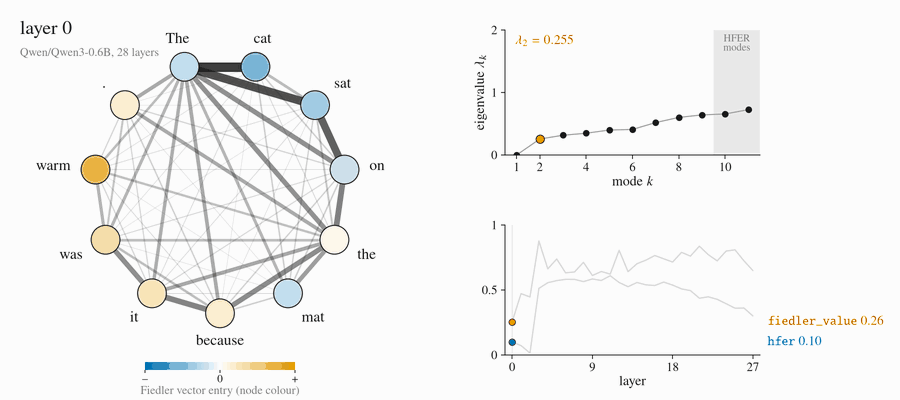
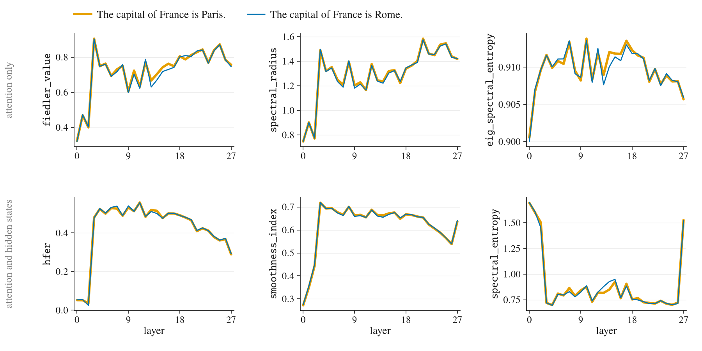
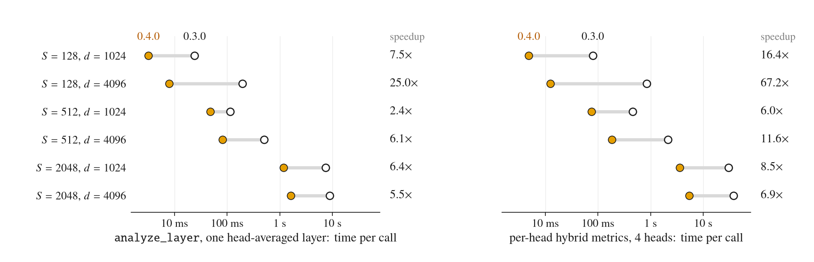

# spectral-trust

[](https://pypi.org/project/spectral-trust/)
[](https://pypi.org/project/spectral-trust/)
[](https://github.com/vcnoel/spectral-trust/blob/main/LICENSE)
[](https://github.com/vcnoel/spectral-trust/actions/workflows/tests.yml)
[](https://colab.research.google.com/github/vcnoel/spectral-trust/blob/main/examples/quickstart.ipynb)

<p align="center">
  <picture>
    <source media="(prefers-reduced-motion: reduce)" srcset="https://raw.githubusercontent.com/vcnoel/spectral-trust/main/docs/assets/hero.png">
    
  </picture>
</p>

<p align="center"><em>Qwen3-0.6B reads one sentence. For each layer: the head-averaged attention graph
(edge width: symmetrised attention; node colour: Fiedler vector), its Laplacian spectrum, and
<code>fiedler_value</code> and <code>hfer</code> up to that layer.</em></p>

**Graph-spectral diagnostics for transformer attention: each layer's attention
becomes a graph over the tokens, and spectral-trust reports its Laplacian
spectrum and the frequency content of the residual stream on it, per layer or
per head.**

## Installation

```bash
pip install spectral-trust
```

From source: `pip install -e .` in a clone of this repository.

## Quickstart

```python
from spectral_trust import GSPConfig, GSPDiagnosticsFramework

config = GSPConfig(model_name="Qwen/Qwen3-0.6B", save_plots=False)
with GSPDiagnosticsFramework(config) as framework:
    framework.instrumenter.load_model(config.model_name)
    result = framework.analyze_text("The cat sat on the mat because it was warm.", save_results=False)

for d in result["layer_diagnostics"]:
    print(d.layer, round(d.fiedler_value, 3), round(d.hfer, 3))
```

This prints one line per layer: the layer index, the Fiedler value of the
head-averaged attention graph, and the HFER of the residual stream on that
graph. It runs on a CPU. `result["layer_diagnostics"]` holds one
`SpectralDiagnostics` per layer with every metric in the metric-families
table below. The notebook
[`examples/quickstart.ipynb`](https://github.com/vcnoel/spectral-trust/blob/main/examples/quickstart.ipynb)
([open in Colab](https://colab.research.google.com/github/vcnoel/spectral-trust/blob/main/examples/quickstart.ipynb))
goes further: one layer with `analyze_layer`, per-head metrics with `heads=`,
and the fast diagnostics.



*The same call on two prompts that differ in one token, on Qwen3-0.6B. Top
row: attention-only metrics; bottom row: hybrid metrics. These are the values
the library returns; the figure is not a detection result.*

## Why graph-spectral diagnostics

The attention weights of a transformer layer define a weighted graph on the
tokens. The eigenvalues of that graph's Laplacian summarise how attention
routes information. The second-smallest, the Fiedler value or algebraic
connectivity, is zero when the graph falls apart into pieces that do not
attend to each other, and small when a few weak edges hold it together. The
eigenvectors form a frequency basis on the tokens: projecting the residual
stream onto them measures how much of the hidden state changes sharply
between tokens that attend to each other (HFER, the high-frequency energy
ratio). Each layer costs one eigendecomposition, with no training and no
labels, and with the default symmetric normalised Laplacian the spectrum lies
in [0, 2] whatever the length of the input, so values are comparable across
prompts.

## Features

- **Attention graphs per layer** from any Hugging Face causal LM that returns
  attention weights: three symmetrisations, uniform or attention-weighted head
  aggregation, and the symmetric normalised (default), random-walk or
  combinatorial Laplacian.
- **Two metric families, tagged in every result**: attention-only metrics
  (Fiedler value, spectral radius, connectivity, eigenvalue energy, entropy
  and HFER) and hybrid metrics that also read the hidden states (Dirichlet
  energy, smoothness index, spectral entropy, HFER, spectral masses).
- **Per-head diagnostics**: one Laplacian per head, five attention-only
  metrics from one batched eigendecomposition, per-head hybrid metrics, and
  head subsets with `heads=`.
- **Fast diagnostics**: row-anchored energies with no eigendecomposition,
  exact top-band HFER, a seeded random projection of the hidden states, and
  Chebyshev band energies for long contexts.
- **Token spans, directed graphs and dynamics**: restrict any diagnostic to a
  span of tokens, compute directed-Laplacian metrics, and take layer-to-layer
  differences of any metric.
- **Probe features**: per-head metrics flattened into feature vectors, with
  cross-layer differences.
- **Command line**: `gsp-cli` analyses one text or compares two, with plots.

## Metric families

Every metric is a function of a specific tensor, and the distinction matters
for both access requirements and interpretation. As of v0.3.0 each metric is
explicitly tagged with its family (`spectral_trust.METRIC_FAMILIES`, also
embedded in every result):

| Family | Input tensors | Metrics | Valid claim |
|--------|--------------|---------|-------------|
| **attention** | attention weights only | `fiedler_value`, `spectral_radius`, `connectivity`, `eigenvalues`, `eig_energy`, `eig_spectral_entropy`, `eig_hfer`, `max_imaginary` | "attention-only": computable from attention maps, no hidden-state access |
| **hybrid** | attention weights **and** residual-stream states | `energy`, `smoothness_index`, `spectral_entropy`, `hfer`, `spectral_masses` | projects residual-stream vectors onto the attention eigenbasis; requires full internals and reflects residual-stream content, **not** attention topology alone |

If you report results as "attention-only", use family-**attention** metrics.
Results with the hybrid metrics should be compared with direct hidden-state
probes at equal access, not with attention-only baselines.

Note on terminology: what Hugging Face returns via `output_hidden_states` are
**residual-stream snapshots** (block outputs). Module-internal activations
(attention-block outputs, MLP activations) are different tensors and are not
consumed by this library.

## Diagnostics

Attention-graph construction: per layer, multi-head attention is aggregated
(uniform or attention-mass-weighted), symmetrized, and turned into a graph
Laplacian. Three normalizations are supported; the **symmetric normalized
Laplacian is the default** since v0.3.0 because its spectrum lies in [0, 2]
independent of sequence length, making metrics comparable across inputs
(the combinatorial and random-walk spectra scale with length).

- **Fiedler value** (λ₂) — algebraic connectivity; low values indicate
  fragmented attention routing.
- **eig_energy / eig_spectral_entropy / eig_hfer** — eigenvalue-only
  counterparts of the classic energy/entropy/HFER diagnostics (v0.3.0).
- **Dirichlet energy / smoothness index** — variation of residual-stream
  signals across attention edges (hybrid).
- **Spectral entropy / HFER / spectral masses** — frequency content of
  residual-stream signals in the attention eigenbasis (hybrid).
- **Spectral velocity** — layer-to-layer derivative of any metric trajectory.
- **Directed diagnostics** — spectral radius and maximum imaginary component
  of the directed random-walk Laplacian.
- **Subgraph isolation** — restrict any diagnostic to a token span (e.g. a
  generated tool call).

## Command line

```bash
# analyze one input
gsp-cli analyze --text "The capital of France is Paris." --model llama-3.2-1b

# compare two inputs side by side (overlaid metric plots)
gsp-cli compare --text1 "..." --text2 "..." --model llama-3.2-1b

# multi-run stability analysis with sampling
gsp-cli analyze --text "..." --runs 5 --temperature 0.7

# offline mode (cached models only)
gsp-cli analyze --text "..." --model llama-3.2-1b --offline
```

`gsp-cli list-models` prints the short model names; `--model` also takes a
Hugging Face model id such as `Qwen/Qwen3-0.6B`.

## Per-head diagnostics

### Head resolution matters

Most attention-graph diagnostics (including earlier versions of this library)
average attention over heads before building the graph. Head averaging
discards head-level structure. Attention heads are specialized: a routing
pattern carried by a few heads is mixed into a near-uniform background when
the heads are summed. LapEigvals (Binkowski et al., EMNLP 2025), an
attention-based hallucination detector, keeps per-head resolution throughout:
its features are per-layer, per-head top-k Laplacian values.

Practical guidance: use head-averaged diagnostics (`aggregate_heads`) for
qualitative layer-trajectory analysis and visualization, but for any
*detection* task, compute metrics per head and let the probe learn which
heads carry signal. The per-head pattern is: symmetrize each head's attention
matrix separately, build one Laplacian per head, and concatenate per-head
metric values as features. `head_aggregation="attention_weighted"` (mass-
weighted averaging) softens but does not remove the aggregation loss.

### Usage

```python
import torch
from spectral_trust import (
    GSPConfig, per_head_metrics_all_layers,
    stack_feature_vector, layer_delta_features,
)

out = model(input_ids, output_attentions=True)     # attentions: [1, H, T, T] per layer

# one Laplacian per head per layer; all heads decomposed in one batched call
diags = per_head_metrics_all_layers(
    out.attentions,
    config=GSPConfig(normalization="sym"),
    token_span=(prompt_len, seq_len),              # restrict to a span of interest
)

diags[12].metric("fiedler_value")                  # [num_heads] for layer 12
features = stack_feature_vector(diags)             # layers x heads x 5, for a probe
dynamics = layer_delta_features(diags, metric="spectral_radius")
```

Five metrics per head come out of a single eigendecomposition, so extracting
all of them costs the same as extracting one: `fiedler_value` (lambda_2),
`connectivity_ratio` (lambda_2/lambda_max), `spectral_entropy_norm`, `hfer`,
and `spectral_radius`. All are family **attention** (attention weights only).
`token_span` takes the induced subgraph *before* building the Laplacian, so
the diagnostic is local to that span rather than to the whole sequence.

## Graph construction options

- `normalization`: `"sym"` (default, length-invariant spectrum), `"rw"`,
  `"none"`.
- `symmetrization`: `"symmetric"` (default), `"row_norm"`, `"col_norm"`.
- `head_aggregation`: `"uniform"` (default) or `"attention_weighted"`.
  Head-averaging discards head-level structure; for detection tasks consider
  per-head analysis on top of the raw attentions.
- `remove_self_loops`: drop the diagonal before building the Laplacian
  (standard in spectral graph theory; changes the Fiedler scale).

## Determinism and precision (v0.3.0)

`DirectedTopologist.get_fiedler_value` now uses an **exact dense solve for
graphs up to 512 nodes** (a few milliseconds on GPU) and a **seeded, deflated
Lanczos** beyond that. Two v0.2.x defects are fixed: the unseeded random
Lanczos start (non-deterministic results) and a `>1e-6` eigenvalue filter that
discarded exactly the near-zero λ₂ regime that connectivity-based diagnostics
are meant to detect. Callers who need bit-identical runs should stay on the
exact path or pass a fixed `seed`.

## Fast diagnostics



*Time per call under each version's defaults, from `benchmarks/end_to_end.py`
(CPU, two threads, synthetic causal attention; best of three runs up to
S = 512, one run above, on a laptop where repeat runs differed by up to about
30% at S ≥ 1024). Left: `analyze_layer` on one head-averaged layer. Right: the
hybrid metrics of 4 heads, timed in 0.3.0 as a loop of `analyze_layer`
because it has no per-head hybrid path. The changes behind the difference are
listed in the changelog.*

The hybrid metrics decompose one S x S Laplacian per layer (O(S³)) and
project d-dimensional signals onto it (O(S²d)). `spectral_trust.fast` and the
`heads=` option avoid, shrink or share that work. Timings and errors below
come from `benchmarks/fast_vs_dense.py` (CPU, two threads, synthetic causal
attention with a sink token; full tables in `benchmarks/results.md`).

| Question | Use | Exact? | Measured |
|---|---|---|---|
| How far do a few tokens' states sit from what they attend to? | `row_dirichlet_energy(W, X, rows)`, `row_value_spread(A, V, rows)` | exact; a row-anchored quantity, related to the Laplacian energies in the docstring | no eigendecomposition, O(\|rows\| S d) |
| HFER on the full basis | `top_band_hfer(L, X)` | exact: equals `eigen_solver="dense"` to ≤ 2e-8 in float32 | 1.9x to 3.9x faster than the dense HFER path |
| Hybrid metrics for wide models | `GSPConfig(project_dim=k)` | estimate: energy and spectral masses unbiased, ratios O(1/√k) | 0.9x to 2.8x per layer; see the error table below |
| Band energies on long contexts | `band_energies(L, X, edges, order)`, `band_entropy(E)` | approximation of the band energies; band entropy is a different quantity from `spectral_entropy` | faster than dense eigh at S = 4096 (below) |
| Only some heads | `heads=` in the per-head functions | exact: equals the full computation sliced | cost proportional to the number of heads |

**Row-anchored energies.** Use them when the question is about specific
tokens, for instance a generated tool call or the final position. Both
functions take `[H, S, S]` weights, so one call covers every head, and they
run on the device of their inputs. Summed over all rows,
`row_dirichlet_energy(W, X)` is twice the combinatorial Dirichlet energy
`tr(X^T (D - W) X)`; the `sym` and `rw` identities are in the docstring.

**HFER above 50 tokens.** `eigen_solver="sparse"` (the default before
0.4.0; now `"dense"`) keeps 50 modes and divides the energy of the top 5 by
the energy of those 50. On the
benchmark's structured signals that ratio was 4x (S = 128) to 30x
(S = 2048) smaller than the full-basis HFER, and the truncated solve was 1.7x
to 6.5x slower than the dense one at every size measured. `top_band_hfer`
returns the full-basis value: since the
spectral energies of a symmetric Laplacian sum to `||X||_F²`, it needs only
the top `num_high_modes(S, 0.1) = S - int(0.9 S)` eigenvectors, the same
mode count as every other HFER path. It applies to `sym` and `none`; the `rw`
eigenbasis is not orthonormal.

**Random projection.** `project_dim=k` multiplies the signals by a seeded
Gaussian matrix before the hybrid metrics; the attention metrics are
untouched, and every layer shares one matrix, so layer trajectories keep
their shape. Median and 99th-percentile relative errors over 200 seeds:

| signals | k | energy | smoothness | HFER | entropy |
|---|---|---|---|---|---|
| i.i.d. Gaussian | 32 | 1.3% / 7.5% | 0.3% / 2.5% | 2.9% / 20% | 0.5% / 1.0% |
| i.i.d. Gaussian | 256 | 0.4% / 2.7% | 0.1% / 0.9% | 1.0% / 6.4% | 0.1% / 0.1% |
| residual-like | 32 | 11% / 47% | 7.1% / 42% | 7.0% / 44% | 10% / 43% |
| residual-like | 256 | 4.1% / 17% | 2.0% / 12% | 1.8% / 9.9% | 3.2% / 13% |

Residual-like signals (a large shared mean, a massive-activation token,
decaying spectrum) have few effective dimensions, and the error then
approaches its worst case, a standard deviation of `sqrt(2/k)`. Use the
projection for screening and ranking at large d, and keep one seed across a
study. Since 0.4.0 the energy is a trace-only sum, so inside `analyze_layer`
the projection saves little time: 0.9x to 1.8x at k = 256 (up to 2.8x at
k = 64, d = 4096), because at S ≥ 2048 the eigendecomposition dominates.
Its clear gain is in band energies on long contexts, below.

**Chebyshev band energies.** `band_energies(L, X, edges=8, order=64,
lambda_max=2.0)` estimates the energy in eight eigenvalue bands from
`order / 2` products with L. Each estimate is non-negative and they sum to
`||X||_F²`; modes within about `π λ_max / (2 order)` of a band edge are
shared between neighbouring bands. Pass `lambda_max=2.0` for `sym` so that the
bands are the same for every input. At S = 4096 and d = 1024, order 32 was
2.3x faster than the library's dense path, and order 64 on signals projected
to 128 dimensions (`project_dim=128`) was 7.9x faster (3.9x faster than
`torch.linalg.eigh`), with band fractions within 2e-4 and band entropy within
1.5%. Projected, it already beats the library's dense path at S = 1024
(2.5x). At S ≤ 1024 and full width it is slower than a dense solve; use
`method="dense"` there. `band_entropy` is the entropy over B bands: a
coarse-graining of the per-mode spectral entropy (with exact band energies,
never larger than it), on a scale bounded by log B instead of log S. Do not
mix the two.

**Head subsets.** The attribution stays outside the library. Pass its scores
as a `[layers, heads]` array:

```python
from spectral_trust import (
    GSPConfig, GraphConstructor, heads_from_scores, per_head_metrics_all_layers,
    per_head_hybrid_metrics_all_layers, row_dirichlet_energy, top_band_hfer,
    band_energies, band_entropy,
)

out = model(input_ids, output_attentions=True, output_hidden_states=True)

scores = attribution_scores                    # [layers, heads], from your method
top = heads_from_scores(scores, k=20)          # [(layer, head), ...], top 20
diags = per_head_metrics_all_layers(out.attentions, heads=top)
hybrid = per_head_hybrid_metrics_all_layers(out.attentions, out.hidden_states,
                                            heads=top)
diags[12].heads                                # heads computed in layer 12
# equivalently a boolean mask, e.g. heads=(scores >= threshold)

# one layer's head-averaged graph and its signals
gc = GraphConstructor(GSPConfig())
W = gc.symmetrize_attention(out.attentions[12])[0]        # [heads, S, S]
L = gc.construct_laplacian(W.mean(0, keepdim=True))[0]    # [S, S]
X = out.hidden_states[13][0]                              # [S, d]

per_head_energy = row_dirichlet_energy(W, X, rows=range(prompt_len, seq_len))
hfer = top_band_hfer(L, X)                                # exact, full basis
E, edges = band_energies(L, X, edges=8, order=64, lambda_max=2.0,
                         project_dim=128)
band_H = band_entropy(E)
```

`(layer, head)` pairs and `[layers, heads]` masks select per layer; plain
indices or a `[heads]` mask select the same heads in every layer.
Unselected heads are dropped before any conversion or decomposition, and
`stack_feature_vector` concatenates the selected heads layer by layer.

## Repository layout

- `src/spectral_trust/` — package source
  - `graph.py` — attention-graph construction (symmetrization, aggregation, Laplacians)
  - `spectral.py` — eigendecomposition and diagnostics (`SpectralAnalyzer`, `SpectralDiagnostics`, `METRIC_FAMILIES`)
  - `per_head.py` — per-head spectral diagnostics (attention and hybrid), head subsets, and probe feature helpers
  - `fast.py` — row-anchored energies, top-band HFER, random projection, Chebyshev band energies
  - `directed_topology.py` — directed Laplacian metrics, GPU Lanczos
  - `framework.py` — end-to-end orchestration (`GSPDiagnosticsFramework`)
  - `instrumentation.py` — model loading and tensor capture
- `examples/` — `quickstart.ipynb` and minimal scripts (hallucination differential analysis, head-masking ablation)
- `benchmarks/` — latency and precision scaling scripts; `fast_vs_dense.py`, `end_to_end.py` and their `results.json` / `results.md`
- `docs/make_assets.py` — regenerates the figures in `docs/assets/` from the library's output
- `notebooks/` — demo notebook
- `tests/` — unit tests, run by `.github/workflows/tests.yml`

## Model compatibility

Works with any Hugging Face causal LM that exposes attention maps
(`output_attentions=True`), including Llama 3.x, Mistral, Qwen 2.x/3.x, Gemma,
and Phi. Hybrid models with linear-attention layers (e.g. Qwen3.5) return
attention weights for their full-attention layers only (Qwen3.5-0.8B: 6 of
24 layers), and `analyze_text` numbers those layers 0, 1, 2, ... in order.
Their attention-family metrics are computed on those layers. The hybrid
metrics, however, pair the i-th attention tensor with `hidden_states[i + 1]`,
which is not the output of that layer; for such models, call `analyze_layer`
with the matching hidden states instead.

## Contributing

Bug reports and pull requests are welcome. See
[CONTRIBUTING.md](https://github.com/vcnoel/spectral-trust/blob/main/CONTRIBUTING.md)
for the development setup, the tests and the code style, and the
[code of conduct](https://github.com/vcnoel/spectral-trust/blob/main/CODE_OF_CONDUCT.md).

## Citation

If you use spectral-trust in your work, please cite the software with the
metadata in
[CITATION.cff](https://github.com/vcnoel/spectral-trust/blob/main/CITATION.cff).

## Changelog

Release notes are in [CHANGELOG.md](https://github.com/vcnoel/spectral-trust/blob/main/CHANGELOG.md).

## License

GNU Affero General Public License v3.0 (AGPL-3.0). For commercial use or
closed-source integration, contact the author for a commercial license.
