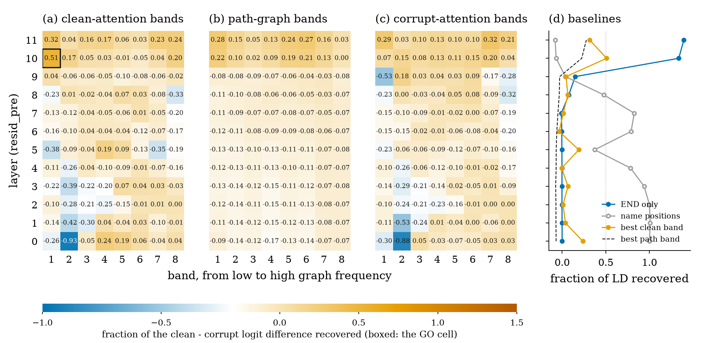

# Frequency-resolved patching

Activation patching asks *where* a computation happens: copy one activation
from a clean run into a corrupted run and see how much of the clean
behaviour comes back. Frequency-resolved patching asks a finer question
about the same activation: *which part of it along the token axis* carries
the effect.

## The method

At the input of block l the residual stream is a matrix X with one row per
token. The clean run's attention at that layer, averaged over heads and
symmetrised, is a graph on the same tokens. Its Laplacian has an orthonormal
eigenbasis U, ordered by eigenvalue: low modes vary little across strongly
connected tokens, high modes separate a token from the tokens it is linked
to. A band of modes U_b is a subspace of the token axis, and

`X' = X_corrupt + U_b U_bᵀ (X_clean − X_corrupt)`

takes that band's coefficients from the clean run and every other
coefficient from the corrupt run. The full band is plain patching; the
empty band leaves the corrupt run unchanged.

```python
import torch
import spectral_trust as st

model = st.SpectralModel.from_pretrained("gpt2")
tok = model.tokenizer
clean = tok("When Mary and John went to the store, John gave a drink to",
            return_tensors="pt").input_ids
corrupt = tok("When Alice and Bob went to the store, Carl gave a drink to",
              return_tensors="pt").input_ids
io, s = tok(" Mary").input_ids[0], tok(" John").input_ids[0]

def logit_diff(logits):
    return logits[:, -1, io] - logits[:, -1, s]

p = st.Patcher(model, clean, corrupt, forward_kwargs={"logits_to_keep": 1})
T = clean.shape[1]
specs = [st.PatchSpec("resid_pre", layer, band=band, basis=basis)
         for layer in range(12)
         for basis in ("clean_attention", "path")
         for band in st.equal_count_bands(T, 4)]
ld = p.patch_many(specs, metric=logit_diff)              # [len(specs), 1]
```

Two controls belong with every band:

- `basis="path"`: the chain graph over positions, whose eigenvectors are
  cosines along the sequence. It has the same number of modes per band and
  knows nothing about the attention. If a positional band recovers as much
  as an attention band, the attention graph adds nothing.
- `basis="random"` with a seed: a Haar-random orthonormal basis, the null
  for a subspace of the same size. Any k-dimensional subspace of a
  T-dimensional token axis carries part of the difference by chance.

And one positional reference: plain patching at the END position only
(`positions=[-1]`), the cheapest explanation of any recovery at the last
token.

## On IOI

A registered pilot ran this on GPT-2 small: the 200 IOI prompts of the
official dataset code (Wang et al., 2022), their ABC counterparts (the IO
name, both S names, then S1 alone replaced by random names), the input of
every block, K = 8 equal-count bands of the clean attention basis, the path
basis and the corrupt attention basis, 50 random bases per band size at the
layer that qualified, and a decision rule fixed before any number was
computed. Recovery is the fraction of the clean − corrupt logit difference
that comes back, as a ratio of means over prompts: clean LD 3.64, corrupt LD
0.28.



*Fraction of the logit difference recovered by patching one band of the
residual stream at the input of each block, GPT-2 small, 200 IOI prompts.
(a)–(c): bands of three bases, low to high graph frequency. (d): plain
patching at END only and at the three name positions, and the best band of
(a) and (b) per layer.*

**One band passes, narrowly.** At the input of block 10, the lowest band of
the clean attention basis (at most 2 to 3 modes of a 14- to 20-token prompt)
recovers 0.51 [0.46, 0.55] of the logit difference. A random subspace of the
same size recovers at most 0.18 (95th percentile of 50 draws), the best path
band at that layer 0.22, and the difference to the best path band is 0.29
[0.24, 0.32] (0.19 to 0.34 with a Bonferroni correction over the 96 cells).
The same band of the corrupt run's attention basis recovers 0.07, so the
band is a property of the clean run's graph. It is the only one of 96 cells
with a recovery of 0.50 or more, and on the odd-indexed half of the prompts
it falls below 0.50.

**The END position is the stronger summary.** Patching the residual stream
at the END position alone recovers 1.34 at the same layer (1.39 at block
11), more than the full patch. The lowest band's projector puts 0.19 of its
diagonal mass on END, against 0.125 for an even spread, so it overlaps the
END position but carries less of what matters. Whoever wants the most
compact description of where the answer sits at layer 10 should patch the
position, not the band.

**Below layer 10 the bands do not add up.** At the inputs of blocks 0 to 9
the eight band recoveries of the clean attention basis sum to between −0.97
and −0.40, while patching all eight recovers 1. Single bands often push the
logit difference the wrong way (−0.93 for the second band at block 0). In
these layers the name positions alone recover most of the difference (1.00
at block 0, 0.78 at block 4), and every band mode has weight on many
positions, so a band patch writes part of each name's clean value onto
other tokens. Band recoveries are not an additive decomposition of the
effect.

## Controls and limits

- Controls: a positional basis (path graph) with bands of the same sizes, 50
  Haar-random subspaces per band size at the qualifying layer, the corrupt
  run's attention basis, and plain patching at END and at the name
  positions. Intervals are 95% paired bootstrap intervals over prompts.
- One model, one task, one partition into 8 bands. The result is a recovery
  of the logit difference, not of the model's behaviour on other inputs.
- The positional baseline wins at the one layer where a band passes, so the
  pilot does not show that graph frequencies describe the IOI computation
  better than positions do. It shows that the method separates bands that
  matter from bands that do not, with controls that can say no.

## Reproduce

`examples/use_cases/frequency_patching.py` recomputes the clean-attention
and path-graph maps and the END-only patch with `st.Patcher` (15 min on 2
CPU threads; `--n-random 10` adds random bases). With the released library
it matches the registered pilot's maps to within 1e-6 (the pilot ran on a
pre-release commit); the full band gives a recovery of 1.000 at every layer.
The pilot's summary is in
`examples/use_cases/outputs/frequency_patching_pilot.json`, the
recomputation in `examples/use_cases/outputs/frequency_patching.json`.
