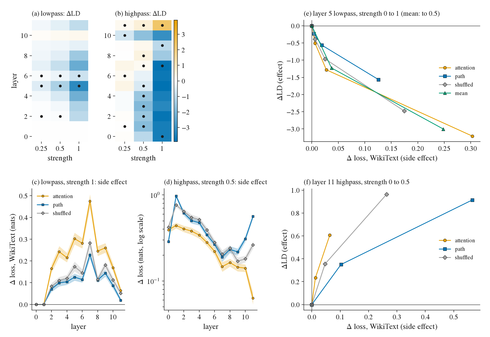

# Graph-frequency steering

The residual stream of a transformer is a signal on the tokens, and each
layer's attention is a graph on the same tokens. `graph_filter` filters the
residual stream along the token axis in that graph's frequency basis:

`X' = X + s (g(L) X − X)`,

with L the Laplacian of the layer's head-averaged, symmetrised attention, g
a low-pass or high-pass response and s the strength. A low-pass filter
smooths each position towards the tokens it is linked to; a high-pass
filter removes that shared part and keeps what distinguishes a token from
its neighbours. This page asks whether such an edit changes a model's
behaviour in a way that depends on the attention graph, and not only on the
size of the edit.

```python
import spectral_trust as st

model = st.SpectralModel.from_pretrained("gpt2")
with st.intervene(model) as iv:
    iv.resid(6).graph_filter("lowpass", cutoff=1.0, strength=0.5,
                             causal=True, token_span=(1, None))
    logits = model(ids).logits
```

Two arguments matter for an honest evaluation:

- `causal=True` filters each position on the graph of its own prefix. The
  default symmetric filter lets a position read later tokens, which leaks
  the next token into a next-token loss and would make a smoothing filter
  look cheaper than it is.
- `token_span=(1, None)` leaves out the first token. In GPT-2 its residual
  norm after block 3 is about 2,700, against a median of 70 for the other
  tokens, and it would dominate any mixing.

## Setup

GPT-2 small. The filter acts on the residual stream after each block
l = 0..11, low-pass or high-pass with cutoff 1.0 on the normalised Laplacian
(spectrum in [0, 2]), at strengths 0.25, 0.5 and 1. The effect is the IOI
logit difference LD = logit(IO) − logit(S) at the END position (200 prompts
of the official dataset code, clean LD 3.64). The side effect is the
next-token loss on 200 WikiText-2 test passages of 32 tokens (clean loss
4.80 nats).

Controls, applied to the same positions with the same filter:

- **path**: the chain graph over positions (`graph="path"`, cosine modes
  along the sequence), a basis that knows only token order;
- **shuffled**: the attention graph with each query row's weights permuted
  among the keys of its own prefix, so every row keeps its weights but not
  which tokens receive them;
- **mean** (low-pass only): each position moved towards the mean of its
  prefix, `x_i + s (mean_{j≤i} x_j − x_i)`, at the same strength.

The path and shuffled edits are rescaled per prompt to the same Frobenius
norm as the attention-graph edit, so a difference between them is not a
difference in the size of the edit. Intervals are 95% percentile bootstrap
intervals over prompts or passages (10,000 resamples).

## Results



*GPT-2 small, attention-graph filters after each block. (a), (b) Change in
the IOI logit difference; dots: the attention graph differs from both
norm-matched controls. (c), (d) Change in WikiText loss per layer, attention
graph against controls of the same edit size (bands: 95% intervals).
(e), (f) Effect against side effect as the strength grows.*

**The edits have large, layer-specific effects.** A low-pass at strength 1
lowers LD by 3.21 [2.80, 3.62] after block 5 (most of the clean 3.64) and
by 0.38 [0.14, 0.62] after block 9, and raises it by 0.27 [0.11, 0.43]
after block 10. A high-pass at strength 0.25 raises LD by 0.40 [0.31, 0.49]
after block 5. After blocks 0 and 1 every mode of the attention graph lies
below the cutoff, so the low-pass changes nothing there; the high-pass at
strength 1 removes most of the signal at every layer and costs 4 to 9 nats.

**Most of the effect on LD comes from the size of the edit.** Path and
shuffled edits of the same size move LD in the same direction in most
cells. The attention graph differs from both controls in 24 of the 66 cells
where its edit is not the identity, 12 times above and 10 times below them:
no consistent advantage on the effect alone.

**The side effect depends on the attention graph.** At strength 1,
smoothing along the attention graph costs 1.4 to 2.5 times the loss of
smoothing of the same size along positions or along the shuffled graph, at
every layer from 2 to 10 (panel c): after block 5, +0.30 [0.28, 0.33] nats
against +0.13 [0.11, 0.14] for the path graph and +0.17 [0.15, 0.20] for
the shuffled graph. Removing the attention graph's low frequencies costs
less than removing those of the controls: after block 11 at strength 0.5,
+0.06 [0.05, 0.07] nats against +0.56 [0.53, 0.60] and +0.26 [0.24, 0.29]
(panel d). Across the 66 cells the loss differs from both controls in 39:
the attention edit costs more than both in 14 (12 of them low-pass) and
less than both in 18 (all high-pass).

**On the trade-off, the attention graph helps in one place.** After block 5
the attention low-pass, the shuffled low-pass and the prefix mean lie on one
curve of effect against side effect (panel e): the attention graph moves
further along it, not to a better point. After block 11 the attention
high-pass raises LD by 0.61 [0.52, 0.69] for 0.06 nats, while the shuffled
graph needs 0.26 nats for 0.96 and 0.05 nats for 0.35, and the path graph
0.10 nats for 0.35 (panel f). That layer was picked after the run, among 24
layer and filter pairs.

**The low-pass is not a mean ablation.** At the same strength the prefix
mean is a much larger edit (relative size 0.34 to 0.60 at strength 1,
against 0.10 to 0.31 for the attention low-pass after blocks 2 to 11) and
costs 2.5 to 4.3 nats at strength 1, against at most 0.48 for the attention
low-pass.

## Controls and limits

- Controls: the positional chain graph and a row-shuffled attention graph,
  both matched to the edit's norm per prompt, and the prefix mean at the same
  strength. Edit size and the Dirichlet energy on the attention graph are
  recorded for every cell in `outputs/graph_filter_steering.json`.
- One model, one cutoff, one task for the effect and one corpus for the
  side effect. The layer-11 trade-off was found by looking, not by a
  registered test.
- The finding that holds across layers is about side effects, not
  steering: along the attention graph, smoothing costs more and sharpening
  costs less than an edit of the same size along positions.

## Related work

Token-axis filters on frozen representations were used for probing by
Tamkin, Jurafsky and Goodman (2020, *Language Through a Prism*, NeurIPS),
on a fixed Fourier basis, and learned as spectral probes by Müller-Eberstein,
van der Goot and Plank (2022, *Spectral Probing*, EMNLP); Verma and Pilanci
(2024, *Towards Signal Processing in Large Language Models*) train
time-frequency filters into the model. Here the filter is a causal
intervention on a frozen model, in the basis of the model's own attention
graph. Evaluating a steering edit by its effect against its side effects
follows AxBench (Wu et al., 2025) and SteerScope (Yang et al., 2026).

## Reproduce

`examples/use_cases/graph_filter_steering.py` (91 min on 2 CPU threads;
`--plot` redraws the figure from `outputs/graph_filter_steering.npz`).
