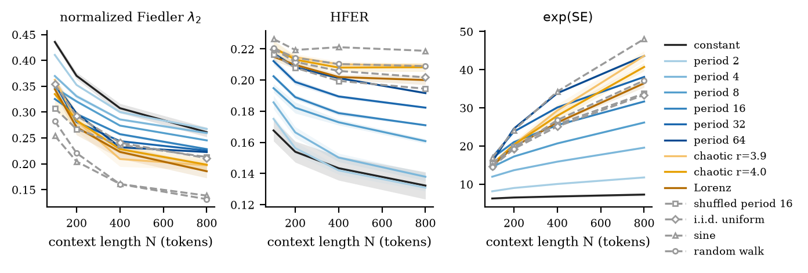
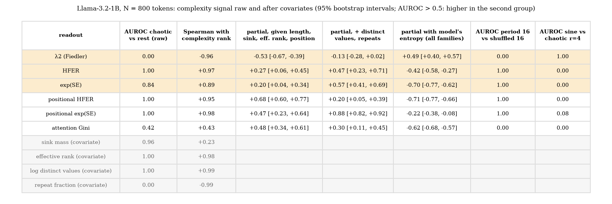
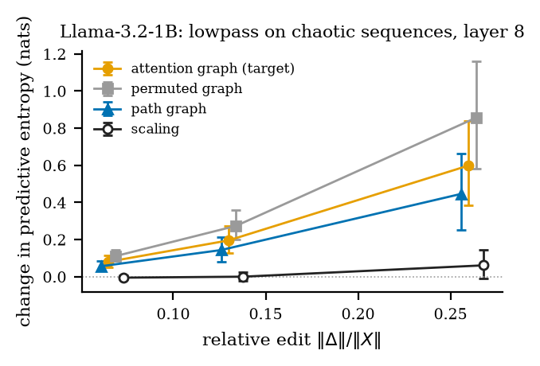
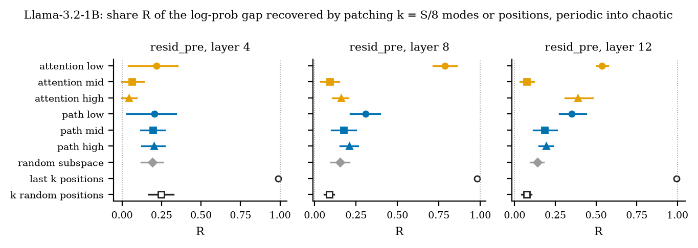
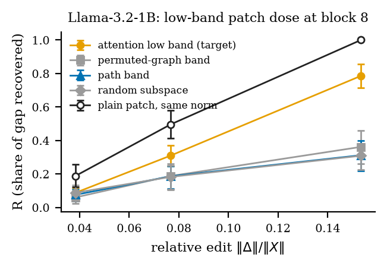

# Numerical in-context learning

Bao, Qi, Liu, Arora, Sarfati, Boullé and Earls, *A Graph Signal Processing
Perspective on Numerical Sequence Representations in LLM In-Context
Learning* (arXiv 2608.03015, accepted at EACL 2027), serialise number
sequences of increasing dynamical complexity (a constant, the logistic map
from period 2 to period 64 and in its chaotic regime, the Lorenz system) and
read each layer's attention as a graph on the tokens, with the hidden states
as signals on it. As the context grows, simple inputs give globally
connected graphs (higher normalized Fiedler value λ2) and smooth hidden
states (lower high-frequency energy ratio, HFER, and fewer effective graph
Fourier modes, exp(SE)); chaotic inputs give localised graphs with more
high-frequency energy. The paper reports no intervention and names the
causal question as open: "frequency-band ablations could test the
functional importance of particular bands".

This page extends their study with the library's tools for that open
question, on small open models: their diagnostics on Llama-3.2-1B (the
smallest model of the paper), a confound audit of the complexity signal, and
two interventions in the spirit of the band ablations they propose,
graph-frequency steering and frequency-resolved patching, each against
matched controls, on Llama-3.2-1B and Qwen3-0.6B. In short:

- their contrast reproduces on Llama-3.2-1B (chaotic against the rest:
  AUROC 1.00 for λ2 and HFER, 0.84 for exp(SE) at 800 tokens);
- the audit adds two covariates worth reporting next to the diagnostics,
  sink mass and the effective rank of the hidden states, which separate the
  same inputs on their own, and control families that locate what the
  diagnostics measure: a smooth, predictable sine sits beyond the chaotic
  map on all three (lower λ2, higher HFER and exp(SE)), so they follow the
  local variation of the sequence more than its predictability;
- low-pass steering along the attention graph makes the predicted next
  value less certain, not more, on both models;
- the lowest attention-graph band carries the prediction of a periodic
  input beyond random and positional bands of the same size, with a
  dose-response, and patching the last positions recovers as much or more.

The notebook `notebooks/05_numerical_icl.ipynb` shows each tool on
Qwen2.5-0.5B on a CPU in under five minutes (see [Reproduce](#reproduce)).

```python
import torch
import spectral_trust as st
from spectral_trust.numeric import (quantize, serialize, value_spans,
                                    profile_from_outputs, next_value_distribution)

sm = st.SpectralModel.from_pretrained("meta-llama/Llama-3.2-1B")
q = quantize(trajectory)                       # [50, 950], bounds from the full run
sp = value_spans(sm.tokenizer, serialize(q[:200]))   # "087,173,642,..."
ids = torch.tensor([sp.input_ids])
out = sm.model(input_ids=ids, output_attentions=True, output_hidden_states=True)

# the paper's construction: BOS dropped and rows renormalised, heads averaged
# after symmetrisation, hidden states entering each layer, combinatorial
# Fourier basis, HFER over the top half of the modes, layer average
prof = profile_from_outputs(out.attentions, out.hidden_states, drop=sp.special)
prof.mean["fiedler"], prof.mean["hfer"], prof.mean["exp_se"]

# the next-value distribution over 000-999 (one restricted softmax for
# Llama 3; digit-wise and hierarchical for digit tokenizers)
next_value_distribution(sm.model, ids, sm.tokenizer).summary()
```

## Reproduction

Llama-3.2-1B base, the smallest model of the paper and its tokenizer (one
token per three-digit value and one per comma): the ten families of the
paper, 8 realizations each, 50 to 400 values (N = 100 to 800 tokens), plus
four control families the paper does not have (below).



*Layer-averaged normalized Fiedler value, HFER and exp(SE) against context
length, Llama-3.2-1B. Lines: mean over 8 realizations; bands: ±1 SD.
Dashed grey: control families.*

**The contrast reproduces, in direction and rough size.** At N = 800,
chaotic inputs (r = 3.9, r = 4.0, Lorenz) have lower λ2 (0.19 against 0.24
for the constant and periodic inputs), higher HFER (0.21 against 0.16) and
higher exp(SE) (40 against 25). Chaotic against the rest separates with an
AUROC of 1.00 for λ2 and for HFER and 0.84 for exp(SE), and the gaps grow
with context (λ2: −0.024 at N = 100, −0.051 at N = 800; HFER: +0.025 to
+0.048; exp(SE): +2.0 to +14.8). The periodic ladder is ordered by period
in all three diagnostics, and the magnitudes sit inside the ranges of the
paper's Fig. 3 for Llama-3.2-3B (λ2 0.2 to 0.5, HFER 0.10 to 0.25).

## Confound audit

The paper's complexity ordering moves several simpler quantities with it:
the number of distinct values in the context (1 for the constant, at most p for
period p, about 300 for chaotic inputs at N = 800), how much of the
sequence an induction head can copy, the attention sink and the effective
rank of the hidden states. `st.confound_audit` asks whether each readout
still says something once they are accounted for:

```python
res = st.confound_audit(
    {"fiedler": l2, "hfer": hfer, "exp_se": exp_se},   # one value per input
    is_chaotic,                                          # or a continuous score
    {"n_tokens": n, "sink_mass": sink, "effective_rank": erank, "mean_position": pos,
     "log_distinct": log_distinct, "repeat_fraction": repeats},
    groups=realization)                                  # bootstrap whole realizations
print(res.to_markdown())
```

Four control families, serialised the same way, separate what the
paper's families tie together: **shuffled period 16** (the period-16 values
in random order: same tokens and same state-distribution entropy, the
paper's complexity measure, but no temporal structure), **i.i.d. uniform**
noise, a **sine** (three periods over 500 values, smooth and predictable)
and a **random walk**.



*Llama-3.2-1B at N = 800 tokens. Columns 2 to 6: the 10 paper families
(80 inputs); "partial": Spearman correlation after the covariates' linear
effect is removed from readout and target. Last two columns: AUROC between
two families (8 inputs each; above 0.5 means higher in the second). 95%
bootstrap intervals over realizations.*

**Two covariates to report next to the diagnostics.** Sink mass alone
separates chaotic from the other inputs with an AUROC of 0.96 [0.93, 0.99],
and the effective rank of the hidden states with 1.00. A cross-validated
logistic regression on length, sink mass, effective rank and position
already reaches an AUROC of 1.00, and none of λ2, HFER or exp(SE) adds to
it on this split. The graph diagnostics and these simpler quantities carry
the same chaotic split; the finer comparisons below show where the
diagnostics carry more.

**Along the ladder, the diagnostics add to the covariates.** Against the complexity
rank of the 10 families, λ2 keeps a partial correlation of −0.53 [−0.67,
−0.39] given length, sink mass, effective rank and position, HFER +0.27
[+0.06, +0.45] and exp(SE) +0.20 [+0.04, +0.34]. Adding the number of
distinct values and the repeat fraction, which correlate at 0.99 and −0.99
with the rank itself, leaves λ2 at −0.13 [−0.28, +0.02] and HFER and
exp(SE) at +0.47 and +0.57: with covariates that collinear, these partial
correlations rest on little residual variation, and the control families
are the cleaner test. The positional (DCT) HFER of the paper's App. H
separates the chaotic inputs as well as the graph HFER (AUROC 1.00) and
keeps a larger partial correlation with the rank (+0.68).

**Order matters, and the control families locate what the diagnostics
measure.** Shuffling the period-16 values moves all three diagnostics
towards the chaotic inputs (λ2 0.228 to 0.213, HFER 0.171 to 0.194, exp(SE)
32 to 34; AUROC 1.00 for each), so the signal is not only the set of
tokens: the diagnostics see temporal structure. The other controls separate
that structure from predictability. The sine, which the model continues with
a predictive entropy of 1.5 nats (5.1 for the chaotic map, 6.9 for i.i.d.
noise), has the lowest λ2 of all 14 families (0.138), the highest HFER
(0.219) and the highest exp(SE) (48): it looks more complex than the
chaotic map on every diagnostic. I.i.d. uniform noise, the least
predictable input, has a higher λ2 (0.211) and a lower HFER and exp(SE)
than the chaotic map (AUROC 0.98 and 1.00). Across all 14 families, λ2
correlates at −0.69 with the model's predictive entropy, but at +0.49
[+0.40, +0.57] once the covariates are removed; HFER goes from +0.67 to
−0.42 [−0.58, −0.27]. The covariates account for the raw association with
the model's uncertainty; what remains is the local variation of the
sequence, which the sine has in abundance.

**For follow-up studies.** The paper's families are a well-chosen ladder of
dynamical complexity; three additions make it sharper at little cost:
report sink mass and the effective rank of the hidden states next to λ2,
HFER and exp(SE) (one `st.confound_audit` call gives the table above), add
a shuffled control of a periodic family, and add a smooth, predictable
family such as a sine, which tells local variation apart from
predictability.

## Steering: does smoothing the numeric tokens smooth the prediction?

If the smooth, low-frequency hidden states of simple inputs are what makes
their continuation confident, then low-pass filtering the residual of a
chaotic sequence along its attention graph should make the predicted next
value less spread out. `edit_with_controls` runs the edit and three
controls whose edit has, item by item, the same norm:

```python
from spectral_trust.numeric import next_value_distribution

def readout(model, ids):
    return next_value_distribution(model, ids, tok).summary()   # mean, std, entropy

res = st.edit_with_controls(
    sm.model, items, readout, layer=8, kind="lowpass", cutoff=0.5, causal=True,
    strengths=(0.1, 0.2, 0.4), positions=numeric_positions, token_span=(1, None),
    controls=("permuted", "path", "scaling"), max_relative_edit=0.3)
res.summary(["entropy", "std"])
```

- `permuted`: the same filter on the attention graph with its nodes
  permuted (position 0 fixed): same edge weights, unrelated token structure;
- `path`: the same filter on the chain graph over positions;
- `scaling`: shrinking the residual at the same positions, no graph.

`token_span=(1, None)` keeps the BOS token out of the graph: with it inside,
the low-pass spreads its residual into every position and the edit is
2.6 to 14 times the residual's norm on Llama-3.2-1B.

On Llama-3.2-1B: 24 chaotic sequences (logistic r = 3.9 and 4.0 and
Lorenz, 8 each, 200 values), causal low-pass with cutoff 0.5 of the
normalised Laplacian on the residual after block 8, at the numeric tokens.
On Qwen3-0.6B: the same 24 sequences at 100 values (400 tokens), after
block 14 of 28, read with the hierarchical digit-wise distribution.



*Llama-3.2-1B: change in the entropy of the next-value distribution (nats;
unedited 5.11) against the size of the edit, for the attention-graph filter
and three controls of the same norm on every sequence. 95% bootstrap
intervals over the 24 sequences.*

**Smoothing makes the prediction less certain, not more, on both models.**
On Llama-3.2-1B, at a relative edit of 0.26, the attention-graph low-pass
raises the predictive entropy by 0.60 [0.39, 0.84] nats and its standard
deviation by 48 [30, 69] (values 0 to 999), with a monotone dose-response
(+0.08, +0.20, +0.60 nats at relative edits 0.06, 0.13, 0.26). On
Qwen3-0.6B, at a relative edit of 0.20, the entropy rises by 0.12 [0.04,
0.22] (+0.02, +0.05, +0.12 along the dose). The test was registered with a
decrease as its prediction, the direction a smoothness account suggests;
on both models the entropy rises instead. Smoother hidden states go with
confident continuations, but making a residual smoother does not make its
continuation confident; the next section asks which band carries the
prediction.

**The graph matters, in its own way.** At equal norm, the
permuted graph raises the entropy more than the attention graph (target
minus permuted: −0.26 [−0.37, −0.16] on Llama, −0.12 [−0.29, −0.02] on
Qwen), the path graph as much or less (+0.15 [+0.02, +0.28] on Llama, +0.00
[−0.04, +0.05] on Qwen), and shrinking the residual by the same amount
changes almost nothing (+0.06 [−0.01, +0.15] and +0.03 [−0.02, +0.09]).
Mixing the residuals of numeric tokens costs information about the values
whatever the graph; along the attention graph it costs less than along a
random graph with the same edge weights. No filter moves the expected
value towards the local linear trend beyond its controls (attention graph:
−11 [−39, +15] on Llama, −1.5 [−7.1, +4.3] on Qwen, in value units).

## Patching: which band carries the simple sequence's prediction?

Frequency-resolved patching (see [Frequency-resolved patching](frequency-patching.md))
takes one band of the clean run's attention basis into the corrupt run.
Here the clean run is a periodic sequence (period 4, 8 or 16) and the
corrupt run a chaotic one (r = 3.9, r = 4.0 or Lorenz) of the same length
and format, 12 pairs of 200 values (401 tokens). The metric is the log
probability of the clean run's next value; R is the share of the clean −
corrupt gap that comes back, as a ratio of means over pairs. Every band has
k = S/8 = 50 modes; the controls have the same dimension: the same bands of
the path basis, a Haar-random 50-dimensional subspace, and plain patching of
50 positions (the last 50, and 50 at random).

```python
p = st.Patcher(sm.model, clean_ids, corrupt_ids, forward_kwargs={"logits_to_keep": 1})
k = S // 8
specs = [st.PatchSpec("resid_pre", 8, band=(0, k), basis="clean_attention"),
         st.PatchSpec("resid_pre", 8, band=(0, k), basis="path"),
         st.PatchSpec("resid_pre", 8, basis="random", n_modes=k),
         st.PatchSpec("resid_pre", 8, positions=list(range(S - k, S)))]
p.patch_many(specs, metric=logp_of_clean_next_value)
```



*R for bands of 50 modes and for 50 positions at the input of blocks 4, 8
and 12, Llama-3.2-1B, 12 pairs. Orange: attention basis; blue: path basis;
grey: random subspace; open markers: positions. 95% bootstrap intervals.*

**The low attention band carries most of the gap at layer 8.** At the
input of block 8 the lowest 50 modes of the clean attention graph recover
R = 0.79 [0.71, 0.86], against 0.15 [0.10, 0.21] for a random subspace of
the same size and 0.31 [0.22, 0.39] for the lowest path band: differences
+0.63 [+0.56, +0.72] and +0.48 [+0.36, +0.60]. The registered gate passes at
blocks 8 and 12 (at block 12: 0.54 [0.50, 0.57], +0.40 and +0.18 over the
random and path bands) and fails at block 4, where no band beats its
controls. The middle and high attention bands recover little (0.09 and 0.16
at block 8).

**The band's effect has a dose-response and beats graph controls of equal
norm** (added after the result above, not registered). Patching a fraction s
of the low band, `edit_with_controls(edit="band_patch", modes=(0, k))`,
recovers R = 0.09, 0.31 and 0.79 at s = 0.25, 0.5 and 1 (relative edits
0.04, 0.08 and 0.15). At s = 1 the same band of a node-permuted attention
graph, the path band and a random subspace, each rescaled to the same norm
on every pair, recover 0.36, 0.31 and 0.31 (target minus each: +4.0 [+2.9,
+5.0], +4.4 [+3.4, +5.3] and +4.5 [+3.8, +5.1] nats of log probability).
Plain patching of every position scaled to the same norm recovers 1.00: the
difference between the two runs sits mostly in the low attention band, but
the band is not a better direction than the difference itself.



*R against the size of the edit at the input of block 8, Llama-3.2-1B,
12 pairs; controls rescaled to the target's norm on every pair. 95%
bootstrap intervals.*

**The band is not the end of the context in disguise, but the end of the
context recovers more.** The low band's projector puts 0.146 [0.140, 0.152]
of its diagonal mass on the last 50 positions at block 8, barely above an
even spread (0.125; `Patcher.projector`), so its recovery is not a copy of
the last positions. Yet patching the last 50 positions recovers 0.98 [0.97,
0.99] at every layer (attention low minus last positions: −0.20 [−0.26,
−0.13] at block 8), while 50 random positions recover 0.09.

**On Qwen3-0.6B the same holds at the middle layer only.** With one token
per digit, a patched pass gives the first (hundreds) digit's distribution,
so the metric is the log probability of the clean value's first digit (12
pairs of 100 values, 400 tokens, k = 50). At the input of block 14 of 28 the
low attention band recovers R = 0.40 [0.09, 0.70], above a random subspace
(+0.37 [+0.04, +0.68]) and the low path band (+0.64 [+0.27, +1.08]), and
level with the last 50 positions (+0.01 [−0.15, +0.18]). At blocks 7 and
21 no band beats its controls, and the last positions recover 0.43 and
0.76. The first-digit gap is small (about 2 nats) and the intervals are
wide.

## Controls and limits

- Small models only: the reproduction and the confound audit on
  Llama-3.2-1B (the smallest model of the paper), the two interventions on
  Llama-3.2-1B and Qwen3-0.6B; not the paper's main Llama-3.2-3B. At most
  800 tokens instead of 2000; 8 realizations per family instead of 20.
- The confound audit removes linear effects of the covariates. The paper's
  ten families make the complexity rank, the number of distinct values and
  the repeat fraction almost collinear, so the control families (shuffled,
  sine, noise, random walk) carry most of the evidence about what the
  diagnostics track.
- Steering: one cutoff (0.5) and three strengths, set from a calibration on
  one sequence so that edits stay below 0.3 of the residual norm (the
  side-effect guard of the graph-filter use cases); cutoff 1.0 changed the
  residual by only 7% at full strength. Controls are matched in norm item
  by item.
- Patching: one band size (S/8), three layers, 12 pairs per model; Qwen is
  read on its first digit only. Intervals are 95% bootstrap intervals over
  pairs or realizations; no correction for the number of layers.
- The paper's construction drops BOS and renormalises the rows. Qwen3 has
  no BOS: its first token is the sink, and under the paper's rule (special
  tokens only) it stays in the graph. On a single period-4 input at
  N = 100 it then carried most of the residual energy (HFER 0.83, against
  0.11 to 0.23 on Llama-3.2-1B). For models without BOS, pass `drop=(0,)` to
  `profile_from_outputs` and report both.

## Reproduce

The pilot's scripts (data generation, run scripts, result files and
figures) live outside the library and call only the functions above:
`quantize`, `serialize`, `value_spans`, `next_value_distribution`,
`profile_from_outputs`, `st.confound_audit`, `st.edit_with_controls`,
`st.Patcher` and `st.bootstrap_ci`.

The notebook `notebooks/05_numerical_icl.ipynb` shows the toolkit on
Qwen2.5-0.5B on a CPU: serialising a sequence and reading its next-value
distribution, the spectral contrast of a constant, period 4, period 16 and
the chaotic logistic map at 100 to 400 tokens (three realisations each), the
confound audit of that contrast, and the low-pass edit with its permuted,
path and scaling controls on six chaotic sequences. It runs in about 4
minutes 20 s with 4 threads once the model (about 1 GB) is downloaded, and it is
saved with its outputs. At that scale it is a demonstration of the
interface: its contrast follows the paper's ordering in HFER at every
length, its four families let the covariates separate chaotic inputs on
their own, and its edit shows the pattern of the steering section against
the permuted graph, within wide intervals.

Runtimes on a laptop CPU with 4 threads: the Llama-3.2-1B reproduction
(14 families, 8 realizations, 4 lengths) 1 h 51 min; the steering dose
25 min on Llama-3.2-1B and 38 min on Qwen3-0.6B (whose digit-wise readout
scores up to 110 digit prefixes per distribution, in about 8 batched passes
on the prompt's cache); frequency-resolved
patching 21 min (Llama) and 10 min (Qwen, first digit).
