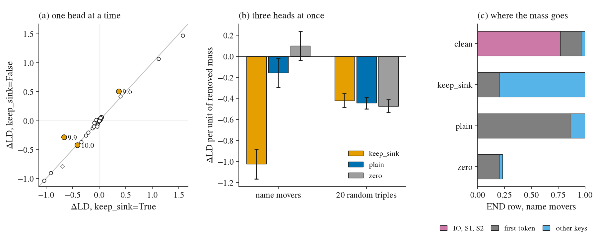

# Edge ablation and the attention sink

Removing an attention edge is not one intervention but several. Once an
entry of an attention row is set to zero, the row no longer sums to one,
and something must happen to the missing mass: leave it missing,
renormalise the row over every remaining key, or renormalise it over the
remaining keys other than the first token, which in most trained models
holds a large share of every row (the attention sink). A pattern hook in
TransformerLens makes this choice silently, in whatever line follows the
zeroing. `remove_edges` makes it an argument:

```python
import torch
import spectral_trust as st

model = st.SpectralModel.from_pretrained("gpt2")
ids = model.tokenizer("When Mary and John went to the store, John gave a drink to",
                      return_tensors="pt").input_ids
S = ids.shape[1]
mask = torch.zeros(S, S, dtype=torch.bool)
mask[S - 1, [1, 3, 9]] = True             # END stops reading Mary, John, John

with st.intervene(model) as iv:
    iv.attention(9, 9).remove_edges(mask)                       # keep_sink=True (default)
    # iv.attention(9, 9).remove_edges(mask, keep_sink=False)    # plain renormalisation
    # iv.attention(9, 9).remove_edges(mask, renormalize=False)  # zero, no renormalisation
    logits = model(ids).logits
```

This page measures how much the choice moves a standard result.

## Setup

GPT-2 small and the 200 IOI prompts of the official dataset code (Wang et
al., 2022; 100 ABBA and 100 BABA templates). The metric is the logit
difference LD = logit(IO) − logit(S) at the END position, the token before
the answer; its clean mean is 3.64 [3.43, 3.85], positive on all 200
prompts. At END, the edges to the IO name and to both occurrences of the S
name are removed, in three ways:

- `keep_sink=True`: the first token keeps its value and the removed mass
  goes to the other keys, in proportion to their attention;
- `keep_sink=False`: the row is renormalised over every remaining key, the
  first token included;
- `renormalize=False`: the entries are zeroed and the row sums to less than
  one.

Head sets: the name movers 9.6, 9.9 and 10.0 together; 20 random triples of
other heads (seed 0); each of the 144 heads alone. Intervals are 95%
percentile bootstrap intervals over prompts (10,000 resamples).

## Results



*Removing the END → IO, S1, S2 edges in GPT-2 small, 200 IOI prompts.
(a) Change in logit difference per head, sink held fixed against plain
renormalisation; name movers in orange. (b) Change per unit of removed
attention mass, three heads at once. (c) Composition of the name movers'
END rows before and after each choice.*

**The same edges, three conclusions.** Removing the name movers' edges to
the names changes the logit difference by

| choice | ΔLD | per unit of removed mass |
|---|---|---|
| `keep_sink=True` | −0.79 [−0.90, −0.68] | −1.02 [−1.17, −0.88] |
| `keep_sink=False` | −0.12 [−0.23, −0.01] | −0.16 [−0.29, −0.02] |
| `renormalize=False` | +0.08 [−0.03, 0.18] | +0.10 [−0.04, 0.24] |

The paired difference between the first two is 0.67 [0.60, 0.74]. With the
sink held fixed, these edges carry a fifth of the logit difference; with
plain renormalisation, a thirtieth; with zeroing, none.

**Why: the removed edges hold most of the row.** At END the name movers put
0.77 of their attention on the three name tokens, 0.20 on the first token
and 0.03 on everything else (panel c). Each choice sends the missing 0.77
somewhere different:

- `keep_sink=True` gives it to the other keys, whose attention is
  multiplied by a median factor of 181 (9.6), 55 (9.9) and 13 (10.0);
- `keep_sink=False` gives most of it to the first token, whose share rises
  from 0.20 to 0.87;
- `renormalize=False` gives it to no key: the rows keep 0.23 of their mass.

None of the three is neutral here. Holding the sink fixed amplifies a few
residual content edges, plain renormalisation amplifies the sink, and
zeroing shrinks the head's output. They are three interventions, and they
answer three questions.

**When the removed mass is small, the choice barely matters.** In the 20
random triples the same edges carry 0.15 of the rows, and the three choices
agree: −0.06 [−0.07, −0.05], −0.06 [−0.07, −0.06] and −0.07 [−0.08, −0.06].
Across the 144 heads taken one at a time, the head rankings under
`keep_sink=True` and `keep_sink=False` have a Spearman correlation of 0.93
(0.80 between `keep_sink=True` and zeroing), 9 of the 10 heads with the
largest effect are shared, and no head shows significant effects of
opposite signs under two choices. The largest single-head disagreement is
the name mover 9.9: −0.66 [−0.74, −0.58], −0.28 [−0.36, −0.20] and −0.15
[−0.23, −0.08].

**Removing the sink edge itself.** The END → first-token edge can only be
removed with `keep_sink=False`. In the random triples it costs −0.13
[−0.14, −0.12] (−0.32 per unit of removed mass), while 3 random content
edges per prompt move LD by +0.01 (+0.06 per unit of mass), in the other
direction. In the name movers, removing the sink edge *raises* LD by +0.14
[0.10, 0.17]: the released mass multiplies their attention to the names.
An edge removal can increase the metric it is meant to probe.

## What to do with this

- Say which choice an edge ablation uses; it is part of the method.
- Report the attention mass the removed edges carried. When it is a large
  share of the row, run all three choices; if they disagree, the measured
  effect is about where the mass went, not about the edges alone.
- Single-head sweeps over many heads are robust to the choice in this
  setting; joint ablations of the heads that matter most are not.

## Controls and limits

- Controls: 20 random head triples (name movers excluded), random content
  edges, the 144 single heads, and the clean attention mass of every removed
  edge.
- One model, one task, the END row only. Backup name movers are known to
  compensate for ablated name movers in IOI (Wang et al., 2022); these
  measurements do not separate that compensation from the redistribution.
- No choice is shown to be the right one. The page shows that the answer
  depends on it.

Miller et al. (2024, *Transformer Circuit Faithfulness Metrics Are Not
Robust*, COLM) found that circuit faithfulness scores shift with the
ablation method; this is the same effect at the scale of one attention row.
On the sink's special role, Sok et al. (2026, *Garbage Attention in Large
Language Models: BOS Sink Heads and Sink-aware Pruning*, EMNLP) find that
heads with high first-token mass are largely redundant.

## Reproduce

`examples/use_cases/sink_ablation.py` (57 min on 2 CPU threads; `--plot`
redraws the figure from `outputs/sink_ablation.npz`). The summary numbers
are in `examples/use_cases/outputs/sink_ablation.json`.
